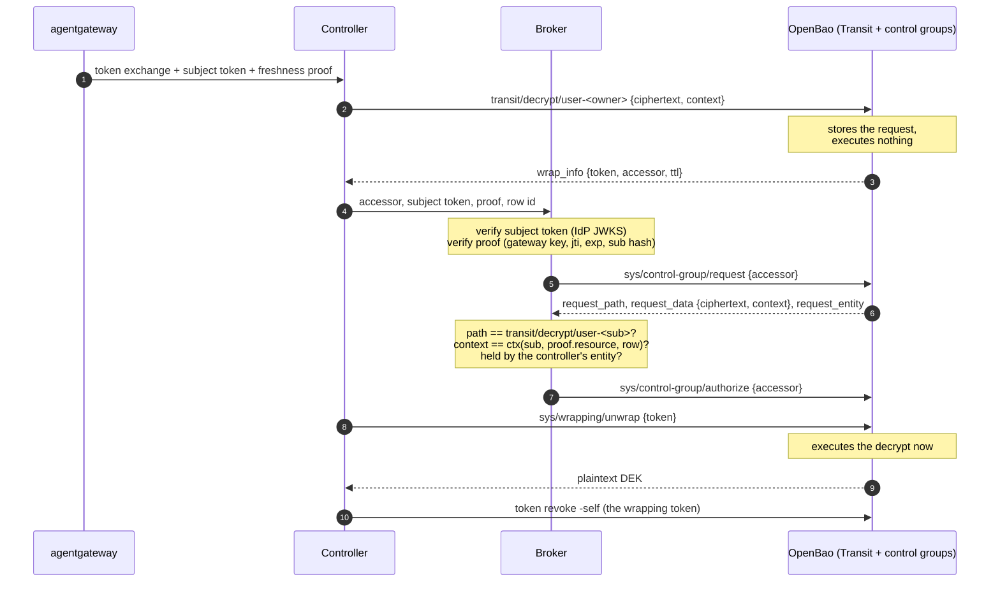

# Mode 3b with control groups

When Mesut re-ran [part 3](https://blog.christianposta.com/credential-brokering-patterns-for-ai-agent-egress-part3/) against OpenBao 2.7.2, the first thing he flagged was the Mode 3b broker. To scope a decrypt to one row it writes a per-row ACL policy (`decrypt-row-<id>`) and mints a token over a role with `allowed_policies_glob="decrypt-row-*"`, and nothing checks what goes *in* that policy. With just those two rights he wrote `path ""` with sudo into `decrypt-row-4711`, minted a token over the role, made a Transit key exportable and turned off audit. He's right, and I don't think the per-row policy design can be patched (more on that below), so it has to change shape.

His suggestion was [control groups](https://openbao.org/docs/concepts/control-groups/), which landed in 2.7.0, and I think it's better than what part 3 had and also better than the KMS variants from part 2 and [2.5](https://blog.christianposta.com/credential-brokering-mode-3-at-scale/). The controller gets a static policy on `transit/decrypt/user-*` with a `control_group` factor on it, so every decrypt it sends is held by OpenBao instead of executed. The broker reviews OpenBao's stored copy of that request and approves it, and that's the only thing the broker can do, ie, it can't decrypt, mint tokens or write policy. Nobody in this design holds a standing decrypt. [`control-groups.sh`](control-groups.sh) is the runnable proof, same style as [`demo.sh`](demo.sh), 18 checks on OpenBao 2.7.2 in dev mode.

## Why per-row policies can't be fixed

An OpenBao ACL is static `(path, parameters, capabilities)` config, and the only runtime-dynamic piece is which policy *names* get attached to a token. So how do you scope a token to one row? You either need a policy that already names that row or you write one, and "write a policy" is an admin capability that OpenBao has no way to narrow. I went through the obvious patches (e.g. parameter constraints, templating, namespaces, policy `ttl`) and none of them hold.

- `allowed_parameters` on the `policy` body only does prefix/suffix globs on values, so a body that starts with the legit stanza and keeps going with `path "*" { ... sudo ... }` still matches.
- [Templated policies](https://openbao.org/docs/concepts/policies/) only inject identity into `path` keys, not into parameter values, so a single static policy can't pin a per-row `context` either.
- Putting the broker in its own namespace just makes it admin of the namespace that holds every user's Transit key.
- The policy `ttl` from 2.3 limits how long a policy lives, not what it says, and OpenBao has no Sentinel.

On KMS this never came up, because a grant can't exceed the key policy plus the IAM condition on `kms:CreateGrant`. The broker's mint authority is bounded by config the broker can't change. Part 3 assumed OpenBao policies gave the same bound, but here the thing the broker writes *is* the config.

## How it works

| Role | Holds | Never holds |
|---|---|---|
| **controller** (ciphertext holder) | the encrypted rows, a token that can *propose* a decrypt | an executable decrypt path |
| **broker** (user verifier + approver) | approve authority on held requests, IdP JWKS, gateway trust bundle, policy | mint authority, policy write, any Transit path, ciphertext |
| **OpenBao** (key custodian) | the KEK, the held request | application data |

The controller keeps the encrypt-only path from your `demo.sh` and gets a decrypt path with a `control_group` block on it, and both live in git like everything else.

```hcl
path "transit/decrypt/user-*" {
  capabilities       = ["update"]
  allowed_parameters = { "ciphertext" = [], "context" = [] }
  control_group = {
    ttl               = "15s"
    self_auth_allowed = false
    factor "broker" {
      controlled_capabilities = ["update"]
      identity {
        group_names = ["cb4a-broker"]
        approvals   = 1
      }
    }
  }
}
```

And this is the broker's entire OpenBao authority.

```hcl
path "sys/control-group/request"   { capabilities = ["update"] }
path "sys/control-group/authorize" { capabilities = ["update"] }
```

The broker logs in through an auth method so its token carries an identity entity (approvers are matched by group membership), and that entity is the only member of `cb4a-broker`. The demo uses AppRole for both identities, and in a real deployment I'd have the broker log in with its SVID (e.g. cert or JWT auth).



So what makes this per-row if the controller's policy covers every user's key? It's the broker's check against `request_data`, which OpenBao has returned from `sys/control-group/request` since [openbao#3601](https://github.com/openbao/openbao/pull/3601). The row context is deterministic from `(owner, resource, row id)`, so the controller computes it at write time and the broker recomputes it at approve time from the subject token it just verified and the resource in the gateway's proof. If the controller holds alice's Slack row during her live GitHub request, the context doesn't match and the broker refuses. If it holds bob's row, the key path doesn't match. If it pairs the GitHub context with the Slack ciphertext, the broker approves (the request names the right row) and Transit's derived key fails the AEAD open, so your check 1 is still there underneath.

That also fixes something part 3 glossed over. The `proof.resource == row.resource` check in the Mode 3b box took the controller's word for which row it was about to decrypt, whereas here the broker reads OpenBao's own copy of the request.

## Running it

```bash
./control-groups.sh
```

It needs `bao` 2.7.0 or later, `openssl` and `jq`, runs on 127.0.0.1 (port 8298, so it doesn't collide with `demo.sh`), and takes about 35 seconds, most of which is waiting out the control group `ttl` in check 13. The broker is about 30 lines of bash in `broker_approve()`, which is enough to show the checks it has to make. These are the results on 2.7.2.

```
PASS  0 [old Mode 3b] per-row policy broker exports alice's key
PASS  1 controller decrypt is held, not executed
PASS  3 unwrap before approval refused
PASS  2 live request: broker approves, controller decrypts that row
PASS  4 controller cannot approve its own request
PASS  5 approver-group member cannot self-approve
PASS  6 broker cannot decrypt alone
PASS  7 broker cannot write policy or mint tokens
PASS  8 another of the user's rows during a live request refused
PASS  9 another user's row during a live request refused
PASS  10 ciphertext from another row fails the AEAD open
PASS  11 batch_input denied before it is held
PASS  12 replayed or expired gateway proof refused
PASS  13 approved and pending requests both die at the ttl
PASS  14 revoking the controller kills its approved requests
PASS  15 wrapping token reusable until revoked, revoke -self closes it
PASS  16 ttl inside identity {} silently does nothing
PASS  17 audit joins hold and approval on the accessor

18 passed, 0 failed
```

Check 0 is your point 1, reproduced on the old design so the two can sit side by side. To make sure the checks fail for the right reasons, I also ran the script with one thing broken at a time (the broker skipping its context check, its key-path check or its `jti` check, the broker getting a Transit path, `allowed_parameters` dropped, `self_auth_allowed = true`, no `control_group` at all) and each one turned the checks it should red (one check for each broker mistake, twelve when the control group is gone).

## What 2.7.2 does that the docs don't say

You'd already found the empty 200, and it turns out to be one of a few places where the parser and the [docs](https://openbao.org/docs/concepts/control-groups/) disagree. Anyone copying the policy from the docs will hit these, so they're worth knowing before you build on control groups.

1. **`controlled_capabilities` is required.** The docs say leaving it out applies the factor to every operation, but 2.7.2 rejects the policy with `factor 0: missing controlled capabilities` ([policy.go#L540](https://github.com/openbao/openbao/blob/v2.7.2/internal/vault/policy/policy.go#L540)).
2. **`ttl` and `self_auth_allowed` go directly under `control_group`.** The parser only accepts `ttl`, `self_auth_allowed` and `factor` there ([policy.go#L475](https://github.com/openbao/openbao/blob/v2.7.2/internal/vault/policy/policy.go#L475)) and doesn't validate keys inside `identity {}`, so the docs' `ttl` and `self_authorization` inside `identity` are silently dropped. A missing `ttl` is a zero `ttl`, and that's your empty 200 with nothing held and nothing executed (check 16). It fails closed, but a 200 looks like success to whoever is debugging it.
3. **An approved wrapping token isn't single-use.** Approvals count while they're younger than the `ttl` ([control_group.go#L219](https://github.com/openbao/openbao/blob/v2.7.2/internal/vault/control_group.go#L219)), and unwrap doesn't consume the token, so every unwrap re-executes the approved decrypt until the `ttl` runs out, with no client token needed. For this design the repeat is the same row the broker approved, but the controller should still `bao token revoke -self` the wrapping token right after it unwraps (check 15).
4. **Self-approval is refused with a 500.** The requester can't approve its own request even if it's in the approver group, which is what we want, but it comes back as `Code: 500 ... token owner cannot be approver` ([control_group.go#L283](https://github.com/openbao/openbao/blob/v2.7.2/internal/vault/control_group.go#L283)) where I'd expect a 403.
5. **Unwrap runs as the requester at unwrap time.** Revoke the controller's token after the broker approved, and the unwrap returns `permission denied` (check 14), so revoking a compromised controller also kills whatever it had approved.
6. **2.7 won't enable audit devices through the API.** The script declares the file audit device in the server config instead. With `log_raw` on, the controller's held request and the broker's `authorize` call share the wrapping accessor, under two different entities, so the audit trail joins (check 17).

Items 1 to 4 seem worth raising upstream, at least as docs fixes.

## What it costs

It's four OpenBao calls per decrypt (held decrypt, review, approve, unwrap) instead of the two in part 3 (mint, decrypt), and each held request is a stored token until its `ttl` expires, so I'd expect all four to land on the active node. That's the opposite of your batch-token finding where decrypts were served by a standby, and I haven't measured it on a Raft cluster yet. A compromised controller can also flood OpenBao with held requests (200 of them left about 200 extra token accessors behind until the `ttl`), so keep the `ttl` close to the freshness proof window and rate-limit at the broker. The broker is still on the synchronous path.

It's also new. Control groups shipped in [2.7.0](https://github.com/openbao/openbao/releases/tag/v2.7.0) on September 23, 2026, the `request_data` field the broker depends on came in a follow-up, so I'd treat it as early. On OpenBao before 2.7 I'd port the broker-unwrap variant from part 2.5 instead, where the broker holds a static decrypt path, computes the context itself from the subject token it verified and returns the DEK. That works, but the broker holds a standing decrypt over every DEK, which is exactly what control groups get rid of.

If you're on OpenBao 2.7 or later and want per-row scoping, I'd use this: two static policies in git, a broker that can approve and do nothing else, and the `ttl` set under `control_group` where the parser actually reads it.
