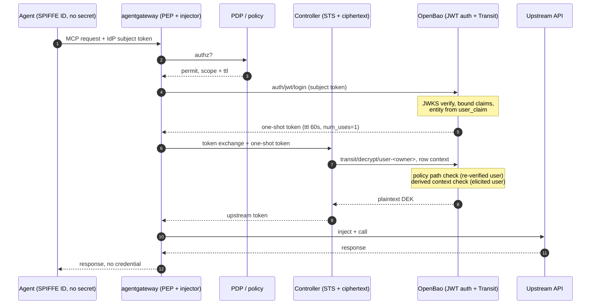

# Mode 3 Without the Cloud: An OpenBao Variant

The Mode 3 pattern from [part 2](https://github.com/christian-posta/christian-posta.github.io/blob/ceposta-cb4a-part2/_posts/2026-08-04-credential-brokering-patterns-for-ai-agent-egress-part2.md) also works fully open source and cloud-agnostic, and it gets simpler, because the component you built by hand already exists inside [OpenBao](https://openbao.org/). It follows this architecture:

![Architecture: an AI agent calls agentgateway with a SPIFFE ID and no secret. The gateway asks a PDP for authorization, then either mints a short-lived dynamic secret from OpenBao (120s lease, revoked after the call) or fetches an encrypted per-user token row and unwraps it through OpenBao Transit with a one-time authorization. The gateway injects the credential, calls the upstream (DB, cloud, internal API, GitHub, Slack, JIRA), returns the response to the agent without any credential, and sends spans and decision logs to OTel.](architecture.png)

I ran everything below on OpenBao 2.7.2 in dev mode and checked each mechanism against the official docs, linked where it first shows up.

## The line 26 TODO: "why a database, why not Vault/BAO?"

Keeping the ciphertext in the application database is correct. Moving the rows into a KV mount changes nothing: if the controller can read the mount with its own identity, that's a standing read on the whole store, the same trap as standing `kms:Decrypt` in Mode 2. The real question is who can turn ciphertext into plaintext, and what has to say yes first. So keep the rows where your app keeps state, and put the referee outside.

## The observation that collapses the broker

Your broker exists for 1 reason: AWS Key Management Service (KMS) can't authenticate the end user, it only sees the controller's IAM role. So you built a separate principal that re-verifies the user and mints a [grant](https://docs.aws.amazon.com/kms/latest/developerguide/grants.html). Your draft says it: "Vault's templated per-entity policies only help when the user is the authenticating identity, and here the controller acts on behalf of users who never authenticate to Vault at all."

That last part is a choice. Let the user authenticate to the vault.

OpenBao's [JWT auth method](https://openbao.org/docs/auth/jwt/) validates a subject token against the IdP JWKS, applies `bound_audiences` and `bound_claims`, and returns a vault token tied to an entity from `sub`. That's exactly your broker's authorize step, but built-in, audited, and fail-closed. The grant becomes a short-TTL, single-use token. The encryption context binding becomes [Transit](https://openbao.org/docs/secrets/transit/) key derivation. The custom broker turns into configuration.

## The mapping

| Your Mode 3 (AWS KMS) | OpenBao equivalent |
|---|---|
| KEK in KMS, never leaves the HSM | Transit key, never leaves the OpenBao barrier |
| Broker re-verifies subject JWT against IdP JWKS | [JWT auth method](https://openbao.org/docs/auth/jwt/), JWKS validation, `bound_audiences`, `bound_claims` |
| `CreateGrant` scoped by `EncryptionContextSubset` | Token from JWT login, [`token_ttl` about 60s, `token_num_uses=1`](https://openbao.org/api-docs/auth/jwt/), templated policy |
| `owner=HMAC(sub)` in EncryptionContext, sealed by AEAD tag | Transit [key derivation](https://openbao.org/docs/secrets/transit/), per-row context with owner and `elicitation_id` |
| Grant subset check at decrypt | [Templated ACL path](https://openbao.org/docs/concepts/policies/) check, token only reaches its own user's key |
| CloudTrail | [Audit device](https://openbao.org/docs/audit/), fail-closed: no log, no request |
| Raw `sub` hidden via HMAC in logs | Audit devices [HMAC request values by default](https://openbao.org/docs/audit/), paths are in clear (see limits) |
| IAM conditions pinning grant shape | Auth role and policy files, versioned in git, testable in CI |
| CEL policy in the broker | `bound_claims` plus ACL policy |

Still 2 trust domains. The controller holds ciphertext with no decrypt path of its own. OpenBao only decrypts for a capability from a user it verified itself. Neither alone can read a credential.

## The two independent checks survive

Check 1, cryptographic, fixed at wrap time. Every row is encrypted under the owner's key with `derived=true` and `context = base64(owner || elicitation_id)`. Wrong context at decrypt time fails the AEAD open, no plaintext. That's your AEAD tag check.

Check 2, authorization, fixed at request time. The controller redeems the one-shot token the gateway got from `jwt/login` with the user's subject JWT. This policy is the only decrypt path in the system, templated on the identity OpenBao just verified:

```hcl
path "transit/decrypt/user-{{identity.entity.aliases.<jwt_mount_accessor>.name}}" {
  capabilities       = ["update"]
  allowed_parameters = { "ciphertext" = [], "context" = [] }
}
```

With 1 Transit key per user, the token only reaches the key of that verified user. That's your grant subset check. `allowed_parameters` matters: without it, 1 `transit/decrypt` call with `batch_input` opens every row of that user on a single use of the one-shot token. The [templated policies docs](https://openbao.org/docs/concepts/policies/) list the alias name as an injectable path parameter.

One detail, I hit it when testing. The alias name is the raw `user_claim` value, no hashing step. For your `HMAC(sub)` privacy trick, either use a pairwise subject identifier from the IdP, or map a claim into alias metadata via [`claim_mappings`](https://openbao.org/docs/auth/jwt/) and template on `{{identity.entity.aliases.<accessor>.metadata.owner}}`. Raw `sub` in key names ends up in audit log paths.

A compromised controller with alice's live request that wants bob's row: its capability only reaches alice's key path, and alice's token with bob's context fails the AEAD open. It controls neither value. Same referee logic, different referee.

## What you built by hand that comes native here

4 of your residual leaks stop being a problem:

- **Grant TTL.** KMS grants have no TTL, you need retirement timers. Vault tokens expire by themselves.
- **The reaper.** You want an independent reaper as a third identity. Lease expiry is the reaper. Nothing to deploy.
- **Single use.** KMS can't do single-use grants. [`token_num_uses=1`](https://openbao.org/api-docs/auth/jwt/) consumes the capability on use, so a leaked but used capability is worth nothing.
- **Rate limiting.** You call KMS rate limiting a weak throttle. OpenBao has [rate limit quotas](https://openbao.org/docs/concepts/resource-quotas/) per mount, path, and auth role, so a drain attempt is visible and slow.

Also, your most underrated leak, the broker as a passive subject-token collector, shrinks: the JWT goes to the vault's auth method, a component that was already in the trusted set. And "pin the grant shape in IAM" becomes 1 auth role and 2 policy files in git, tested in CI against a dev server.

## The flow

The sequence below is the whole read path, numbering follows my diagram:



If anything is off, the decrypt never happens and the failure is in the audit log.

Freshness comes from the same move, on 1 condition: only the gateway can reach `auth/jwt/login`. Then the one-shot token only exists because a real subject token hit the gateway seconds ago, dies in 60 seconds, and dies on first use, and your "no background refresher" rule stays. The controller also sees the subject token (it's the token exchange input), so if it can reach the login path it can replay a captured token for as long as the IdP token lives. Lock the login path to the gateway at the network layer, e.g. mTLS or a waypoint policy on `/v1/auth/jwt/login`. [`token_bound_cidrs`](https://openbao.org/api-docs/auth/jwt/) on the role doesn't do this alone: OpenBao checks it at login and on every use (check 8), so 1 list can't say "the gateway logs in, the controller uses the token".

## The second path: stop storing what you can mint

Your closing residual, refresh tokens as crown jewels, has a vault-native answer. For upstreams with a [secrets engine](https://openbao.org/docs/secrets/databases/) (databases, cloud providers, internal services with their own Secure Token Service), there's no row to protect. The gateway mints a dynamic secret on the live request, lease of about 120 seconds, injects, calls, revokes on response. The credential never persists. The stored-token path is only for upstreams that can't mint, things like GitHub and Slack.

So your tiering knob gets a third setting: which backends need stored credentials at all.

## The proof

Same shape as yours, 2 identities and negative tests, run on OpenBao 2.7.2 in dev mode with a local test IdP key, `token_ttl=60s`, `token_num_uses=1`, per-user derived Transit keys, and an encrypt-only controller policy. You can reproduce these checks, plus TTL, CIDR, dynamic secret, and audit fail-closed checks, with [`demo.sh`](demo.sh) in this repo, it needs only `bao`, `openssl`, and `jq`, and runs on 127.0.0.1. Actual results:

```
1) derived context binding: decrypt alice's row with bob's context
   Code: 400. * cipher: message authentication failed

2) POSITIVE: alice's subject JWT -> jwt/login -> one-shot token -> decrypt alice's row
   plaintext returned

3) token reuse: same one-shot token, second call
   * permission denied

4) cross-user: fresh alice token against transit/decrypt/user-bob
   Code: 403. * permission denied

5) NEGATIVE: controller's own identity, raw decrypt on a real row
   Code: 403. * permission denied

6) expired subject JWT at login
   * error validating token: invalid expiration time (exp) claim: token is expired

10) batch_input: fresh one-shot token, 2 of alice's rows in 1 call
   * permission denied
```


The component holding the ciphertext can't decrypt it with its own credentials. The capability that can is minted per verified user, dies in 60 seconds, dies on first use.

## Where this still leaks

Same honesty, applied to this variant:

1. **OpenBao is now the referee you must protect.** KMS gives you a managed HSM boundary for free. Here the barrier key is in the memory of a process you run. Mitigations are operational: dedicated hardened cluster, auto-unseal against an external root of trust, no shared pipeline. Your "independence is an operational claim" warning applies to OpenBao versus controller too.
2. **The wrap-path plaintext DEK stays.** Whatever encrypts locally holds the key at that moment. Same limit, same writer-path split as the fix direction.
3. **The gateway still sees subject tokens on live requests.** A compromised gateway can collect them and mass-login while they're valid. Short IdP TTLs, audience binding, and [login rate quotas](https://openbao.org/docs/concepts/resource-quotas/) let you see it and slow it down, but they don't prevent it.
4. **Key count grows with users.** Key lifecycle joins the identity lifecycle. Derived contexts on a single key are the simpler variant if key sprawl worries you.
5. **`token_num_uses=1` counts every request.** A token lookup or renew burns the use and the decrypt fails. The redeem path must be exactly 1 call.
6. **User identifiers can leak into audit paths.** [Audit devices](https://openbao.org/docs/audit/) hash values but log paths in clear. Use a pairwise identifier or the alias-metadata templating above.
7. **Broker bypass stays.** All of this only matters if the agent structurally can't reach the upstream except through the gateway. Egress enforcement (ztunnel plus a waypoint in ambient) ships with the pattern or the story has a hole.

## The strategic point, extended

Your post ends with 2 answers to credential concentration, topological and cryptographic. This variant adds a third axis: a referee you own versus a referee you rent. The same 3 roles (ciphertext holder, user verifier, key referee) written in OpenBao run the same on any cloud or on none, and the whole boundary is source you can inspect and config you can review. Many teams that care about agent egress are on-prem or on sovereign clouds exactly because of credential concentration fears. I think the post gets stronger if Mode 3 is a pattern with 2 reference implementations, KMS grants and vault-native tokens.

The runnable version is [`demo.sh`](demo.sh) in this repo. If you want, I can turn this into a section for the post.

## Follow-up: Mode 3b with control groups

[`CONTROL-GROUPS.md`](CONTROL-GROUPS.md) and [`control-groups.sh`](control-groups.sh) take the broker variant from part 3 and replace its per-row policy writes with OpenBao 2.7 [control groups](https://openbao.org/docs/concepts/control-groups/). The controller's decrypts are held until the broker approves OpenBao's stored copy of the request, and the broker's only OpenBao rights are review and approve, so it can't escalate the way the per-row policy broker can. 18 checks, OpenBao 2.7.2, same requirements as `demo.sh`.
